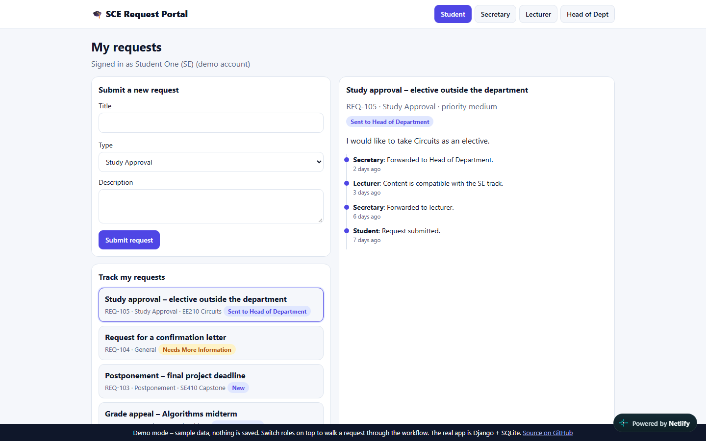
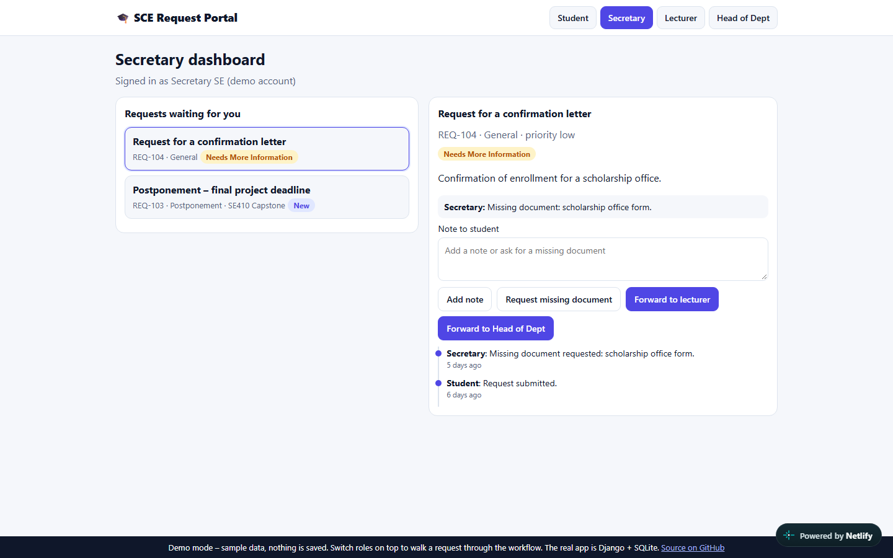
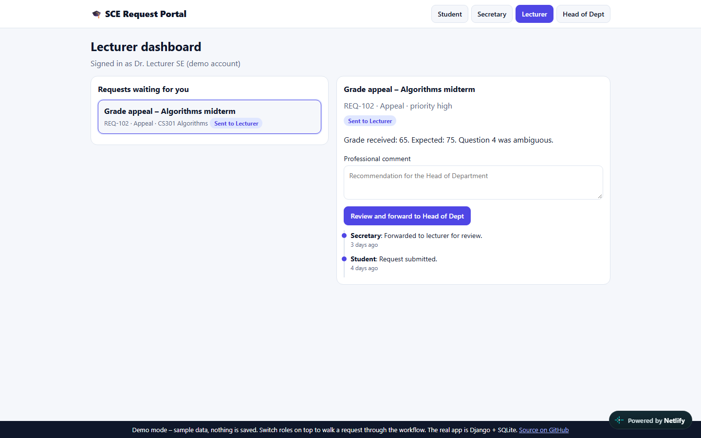
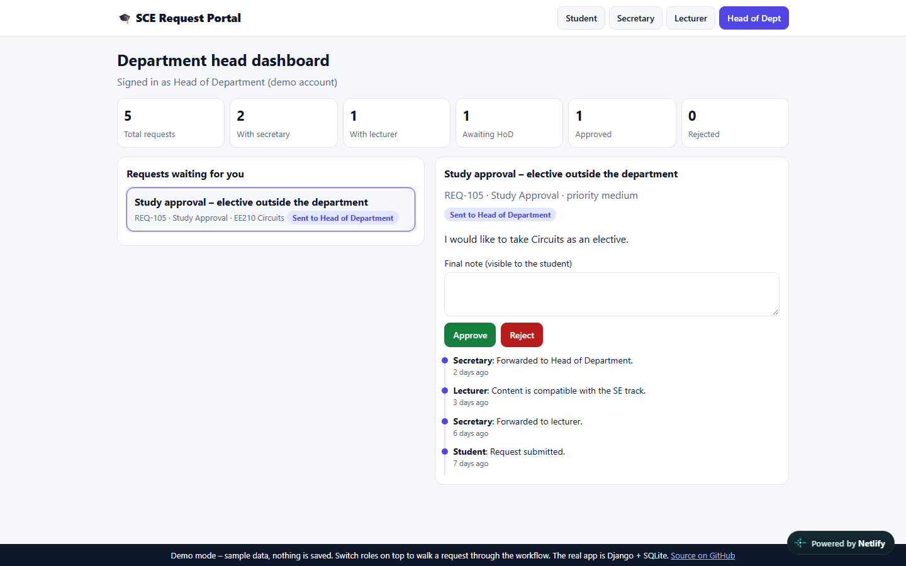
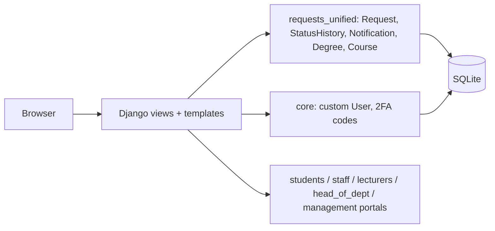

# Student Request Management System

A Django web app that replaces paper student forms with a digital workflow: students submit requests, and a secretary, lecturer and head of department review, forward and decide them, with full history and notifications.


### [▶ Live Demo](https://student-requests-demo.netlify.app)

The live demo is a static, clickable version with sample data (switch role at the top and walk a request through the workflow). The real application is the Django project in this repository.

| | |
|---|---|
|  |  |
|  |  |

## Features

- **Roles:** student, academic secretary, lecturer, head of department, admin, with role-based access control.
- **Requests:** study approval, appeal, postponement and general requests, with file attachments and input validation.
- **Workflow:** secretary reviews and adds notes, can ask for a missing document, and forwards to a lecturer or to the head of department; the lecturer adds a professional comment; the head of department approves or rejects with a final note.
- **History and notifications:** every status change is recorded and the student is notified.
- **Dashboards:** student summary, staff and lecturer queues, department-head statistics.
- **Sign-up** with degree selection and validation (university email domain, 9-digit student ID, password strength).
- **Two-step login:** password, then a 6-digit code sent by email.

## Architecture



## Tech stack

| Layer | Technology |
|---|---|
| Framework | Django 6, server-rendered templates |
| Database | SQLite |
| Auth | Django auth with a custom `core.User` model, role field, email verification codes |
| Tests | Django `TestCase` (167 tests) |

## Quick start

Requires Python 3.12+.

```bash
python -m venv .venv
# Windows: .venv\Scripts\activate   |   macOS/Linux: source .venv/bin/activate
pip install -r requirements.txt
python manage.py migrate
python manage.py seed_demo      # one demo user per role + sample requests
python manage.py runserver
```

Open http://127.0.0.1:8000/login/. Login uses a two-step email verification: with no SMTP settings the 6-digit code is printed in the terminal running `runserver`.

### Configuration

| Variable | Default | Purpose |
|---|---|---|
| `DJANGO_SECRET_KEY` | insecure dev fallback | Set a long random value in any shared environment |
| `DJANGO_DEBUG` | `true` | Set to `false` outside local development |
| `DJANGO_ALLOWED_HOSTS` | `127.0.0.1,localhost` | Comma-separated host list |
| `EMAIL_HOST_USER`, `EMAIL_HOST_PASSWORD` | unset (codes print to console) | SMTP login for real verification emails |

## Demo credentials

Created by `python manage.py seed_demo`. Demo data for local use only.

| Role | Email | Password |
|---|---|---|
| Student | `student@ac.sce.ac.il` | `Student1!` |
| Secretary | `secretary.se@ac.sce.ac.il` | `Secretary1!` |
| Lecturer | `lecturer.se@ac.sce.ac.il` | `Lecturer1!` |
| Head of Dept | `hod@ac.sce.ac.il` | `Head1234!` |
| Admin | `admin@ac.sce.ac.il` | `Admin123!` |

## Tests

```bash
python manage.py test tests
```

Result: 167 tests, OK (8 skipped). The `test_*.py` files in the repository root are manual scripts, not part of the suite.

## Security notes

- `SECRET_KEY`, `DEBUG`, `ALLOWED_HOSTS` and SMTP credentials are read from environment variables; the database, uploads and collected static files are git-ignored.
- An earlier version of this repository had an SMTP app password committed. It has been removed from the code and revoked, but it remains in the git history, so never reuse it.
- Role checks are enforced in the views (`staff_required`, and similar decorators), not only in the templates.
- Passwords are validated for length and character classes at sign-up.

## Roadmap

- Rate-limit the login and verification-code endpoints.
- Move from SQLite to PostgreSQL for deployment.
- Exportable reports for the head of department.
- Replace the manual root-level scripts with proper tests.
